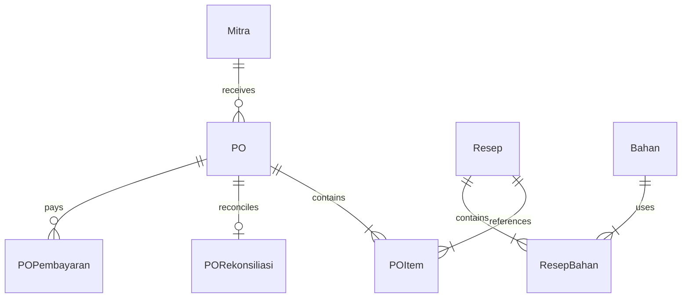
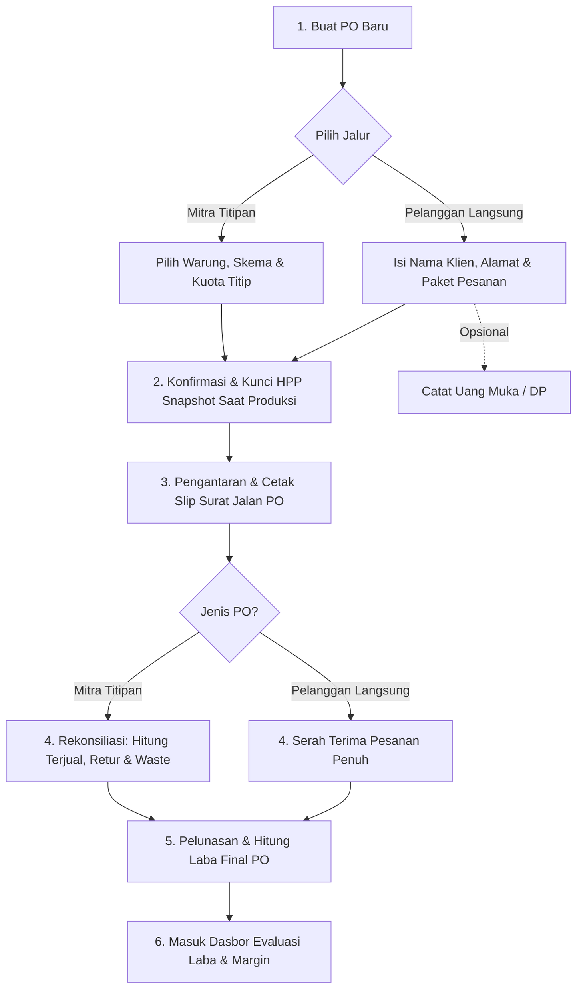

# PRD: Sistem Perhitungan HPP, Operasional, dan Laba Titip Jual Churros

**Versi:** 1.1 (Revisi Transaksi PO, Font Awesome & Daftar Task)\
**Jenis usaha:** UMKM churros pre-order dengan penitipan ke warung dan toko\
**Tanggal:** 25 Oktober 2026

## 1. Ringkasan

Sistem ini membantu pemilik usaha churros menghitung **HPP (Harga Pokok Produksi)**, **biaya operasional**, dan **laba bersih** dari setiap produksi dan setiap pengantaran. Transaksi kini dikelola berbasis **Purchase Order (PO)** sebagai unit transaksi utama, baik untuk mitra titipan (konsinyasi warung/toko) maupun pesanan langsung dari pelanggan (pre-order).

Pemilik dapat menambah atau menghapus mitra titipan, produk, bahan baku, dan komponen biaya kapan saja tanpa mengubah struktur sistem. Tujuan utamanya: pemilik tahu dengan pasti **tempat titipan mana yang untung, mana yang rugi**, berapa margin pesanan langsung, serta rekomendasi kuota titipan yang paling menguntungkan.

## 2. Latar Belakang dan Masalah

- Usaha berjalan dengan dua jalur penjualan: penitipan ke warung/toko (konsinyasi) dan pesanan pre-order pelanggan langsung.
- Pada model titip jual (konsinyasi), tidak semua produk terjual: ada **sisa/retur** yang menjadi kerugian (waste).
- Setiap mitra bisa punya syarat berbeda (harga setor, komisi, bagi hasil, beli putus, jarak antar, frekuensi setor).
- Tanpa nomor transaksi tunggal (PO), pencatatan titipan, pembayaran uang muka (DP), pelunasan, dan retur sering tercecer.
- Tanpa snapshot HPP saat produksi, fluktuasi harga bahan di pasar dapat merusak keakuratan laporan laba transaksi masa lalu.

## 3. Tujuan dan Metrik Keberhasilan

| Tujuan | Metrik |
| --- | --- |
| HPP per pcs dapat dihitung otomatis dari resep dan harga bahan | HPP terhitung kurang dari 1 menit setelah harga bahan diperbarui |
| Transaksi tercatat rapi per PO untuk semua jalur penjualan | Nomor PO otomatis terbuat dan dapat dicari kurang dari 5 detik |
| Laba per PO dan per mitra terlihat jelas | Laporan laba estimasi & final tersedia untuk setiap PO |
| Mitra dan komponen biaya fleksibel | Tambah atau hapus mitra/biaya tanpa bantuan developer |
| Pencatatan titip, terjual, dan sisa mudah | Input satu rekonsiliasi setoran PO kurang dari 1 menit |
| Keputusan berbasis data | Rekomendasi mitra paling untung, titik impas (BEP), dan evaluasi retur |

## 4. Pengguna

| Peran | Kebutuhan |
| --- | --- |
| **Pemilik (admin)** | Mengelola semua data, membuat PO, melihat laporan laba estimasi & final, mengatur harga |
| **Staf/kurir (opsional, fase 2)** | Mencatat pengantaran dan pengambilan sisa/setoran di lapangan berbasis nomor PO |

Fase awal difokuskan untuk satu pengguna (pemilik).

## 5. Ruang Lingkup

**Termasuk (MVP):**

- Master data bahan baku, resep varian produk, dan mitra titipan
- Perhitungan HPP otomatis per resep dan snapshot HPP saat produksi
- Pengelolaan biaya operasional (tetap bulanan dan variabel pengantaran)
- **Pengelolaan transaksi berbasis Purchase Order (PO):**
  - Nomor PO otomatis (`PO-YYYYMM-NNN`)
  - Status PO bertahap: Draft, Dikonfirmasi, Diproduksi, Dikirim, Selesai, Dibatalkan
  - Pembayaran berjenjang: DP (uang muka) dan Pelunasan
- Rekonsiliasi setoran: jumlah terjual, sisa layak retur, dan sisa rusak/dibuang (waste)
- Perhitungan laba per PO (estimasi dan final), per mitra, dan per periode
- Dasbor analitik, simulasi *What-If*, dan ekspor/cetak slip nota konsinyasi
- Sistem desain Bakery Flour dengan integrasi ikon Font Awesome standar

**Tidak termasuk (untuk saat ini):**

- Integrasi payment gateway otomatis (masih pencatatan transfer/tunai manual)
- Modul akuntansi pembukuan ganda lengkap (neraca, pajak formal)
- Aplikasi portal mandiri khusus pemilik warung mitra
- Manajemen absensi dan penggajian karyawan detail

## 6. Istilah dan Rumus Perhitungan

### 6.1 HPP per pcs

```
Biaya Bahan per Batch   = Σ (jumlah bahan × harga bahan per satuan)
Biaya Produksi Langsung = Biaya Bahan + Tenaga Kerja Langsung + Kemasan + Gas/Listrik per batch
Hasil Efektif           = Jumlah Hasil Jadi (pcs) × (100% − % Susut Produksi)
HPP per pcs             = Biaya Produksi Langsung ÷ Hasil Efektif
```

Hasil jadi dihitung setelah memperhitungkan **susut/gagal produksi** (misalnya 3%).

### 6.2 Biaya operasional

- **Operasional tetap** (per bulan): sewa tempat, internet, langganan, penyusutan alat. Dialokasikan per pcs: `Biaya Tetap Bulanan ÷ Perkiraan Produksi Bulanan`.
- **Operasional variabel**: bensin/ongkos antar, plastik/stiker, biaya admin. Dibebankan per pengantaran PO atau per pcs.

### 6.3 Skema titip jual (dapat dipilih per mitra)

| Skema | Cara hitung pendapatan pemilik |
| --- | --- |
| **Harga setor tetap** | Mitra membayar harga setor per pcs terjual; mitra mengatur harga jual sendiri |
| **Komisi persen** | Harga jual konsumen × (100% − komisi mitra) |
| **Bagi hasil** | (Harga jual − HPP) dibagi sesuai persentase kesepakatan |
| **Beli putus** | Mitra membayar seluruh jumlah yang dititip di muka, tanpa hak retur |

### 6.4 Laba Konsinyasi Umum

```
Pendapatan Bersih Mitra = Σ (pcs terjual × pendapatan per pcs sesuai skema)
Biaya Produk Dititip    = pcs dititip × HPP per pcs
Biaya Operasional Mitra = ongkos antar + alokasi biaya tetap
Laba Bersih Mitra       = Pendapatan Bersih − Biaya Produk Dititip − Biaya Operasional Mitra
Margin (%)              = Laba Bersih ÷ Pendapatan Bersih × 100
Tingkat Terjual (%)     = pcs terjual ÷ pcs dititip × 100
```

### 6.5 Titik impas (break-even) per mitra

```
BEP (pcs) = Biaya Operasional Mitra ÷ (Pendapatan per pcs − HPP per pcs)
```

### 6.6 Laba per PO (Estimasi & Final)

Setiap transaksi berjalan di bawah satu nomor PO (`PO-YYYYMM-NNN`). Laba dihitung dalam dua tahap:

#### A. Estimasi Laba (Sebelum Disetor / Saat PO Dibuat & Dikirim)

- **PO Titip Jual (Mitra):**
  ```
  Estimasi Omzet  = Σ (pcs dititip × harga setor/tarif skema)
  Beban HPP       = Σ (pcs dititip × HPP snapshot)
  Biaya Ops       = ongkos antar + (pcs dititip × alokasi tetap per pcs)
  Estimasi Laba   = Estimasi Omzet − Beban HPP − Biaya Ops
  ```
- **PO Pelanggan Langsung (Pre-Order):**
  ```
  Estimasi Omzet  = Σ (pcs pesanan × harga jual konsumen)
  Beban HPP       = Σ (pcs pesanan × HPP snapshot)
  Biaya Ops       = ongkos antar / delivery aktual
  Estimasi Laba   = Estimasi Omzet − Beban HPP − Biaya Ops
  ```

#### B. Laba Final (Sesudah Rekonsiliasi Setoran & Pengiriman Selesai)

- **PO Titip Jual (Mitra):**
  ```
  Omzet Realisasi = Σ (pcs terjual × pendapatan per pcs sesuai skema)
  Beban HPP Final = (pcs dititip − pcs sisa kembali layak) × HPP snapshot
  Biaya Ops Final = ongkos antar aktual + (pcs dititip × alokasi tetap)
  Laba Final      = Omzet Realisasi − Beban HPP Final − Biaya Ops Final
  Margin Final    = (Laba Final ÷ Omzet Realisasi) × 100
  ```
  *Catatan:* Sisa yang rusak atau kedaluwarsa (waste) tidak dapat dijual kembali sehingga HPP-nya tetap menjadi beban kerugian pemilik. Sisa kembali yang masih layak dapat dialihkan ke stok baru.

- **PO Pelanggan Langsung (Pre-Order):**
  ```
  Omzet Realisasi = Total pembayaran diterima (DP + Pelunasan)
  Beban HPP Final = Σ (pcs diserahterimakan × HPP snapshot)
  Biaya Ops Final = ongkos kirim / transportasi aktual
  Laba Final      = Omzet Realisasi − Beban HPP Final − Biaya Ops Final
  ```

## 7. Contoh Perhitungan (Ilustrasi Acuan)

### 7.1 Produksi Satu Batch (50 pcs)

| Komponen | Biaya |
| --- | --- |
| Bahan (tepung, telur, mentega, gula, kayu manis, minyak) | Rp 100.000 |
| Saus/topping cokelat | Rp 30.000 |
| Kemasan (50 pcs × Rp 500) | Rp 25.000 |
| Gas dan listrik | Rp 10.000 |
| Tenaga kerja langsung | Rp 35.000 |
| **Total produksi langsung** | **Rp 200.000** |
| **HPP per pcs** | **Rp 4.000** |

Alokasi biaya tetap operasional per pcs: **Rp 800 / pcs**.

---

### 7.2 Contoh 1: PO Titip Jual ke Warung A (`PO-202610-001`)

- **Karakteristik:** 20 pcs churros original, harga setor Rp 6.000/pcs, ongkos antar Rp 5.000.
- **Hasil penjualan:** Terjual 16 pcs, sisa 4 pcs (retur).
- **Perhitungan:**
  - Omzet realisasi: 16 × Rp 6.000 = Rp 96.000
  - Beban produk dititip (HPP snapshot): 20 × Rp 4.000 = Rp 80.000
  - Biaya operasional antar: Rp 5.000
  - Alokasi biaya tetap: (opsional / masuk komponen umum)
  - **Laba bersih PO Warung A: Rp 11.000** (margin 11,5%)
  - Tingkat terjual (sell-through): 80% (16 dari 20 pcs)

---

### 7.3 Contoh 2: PO Pelanggan Langsung / Pre-Order (`PO-202610-002`)

- **Karakteristik:** Pesanan acara arisan kantor (Pak Budi), 10 box Churros Chocolate Melted Dip (total 50 pcs).
- **Harga jual:** Rp 10.000 / box (Total Omzet = Rp 100.000).
- **HPP produksi:** 10 box × Rp 4.800 = Rp 48.000 (HPP snapshot terkunci).
- **Biaya operasional antar (kurir / bensin):** Rp 15.000.
- **Pembayaran:** DP 50% (Rp 50.000) saat pemesanan, pelunasan 50% (Rp 50.000) saat pesanan diserahkan.
- **Perhitungan:**
  - Total omzet: Rp 100.000
  - Beban HPP: Rp 48.000
  - Biaya operasional antar: Rp 15.000
  - **Laba bersih PO Langsung: Rp 37.000** (margin 37,0%)

Contoh komparasi di atas menunjukkan:
- **PO titip ke warung untung Rp 11.000** (ada beban retur dan harga setor grosir).
- **PO langsung untung Rp 37.000** (harga jual konsumen penuh, tanpa potongan komisi toko).

## 8. Kebutuhan Fungsional

Prioritas: **P0** = wajib MVP, **P1** = penting, **P2** = nanti.

### 8.1 Master Bahan Baku (P0)

- FR-01: Tambah, ubah, hapus bahan (nama, satuan beli, harga beli, rasio konversi satuan resep).
- FR-02: Riwayat perubahan harga bahan; HPP pada PO lama tidak berubah karena sistem mengunci snapshot HPP.
- FR-03: Pembelian bahan dapat dicatat dengan rasio konversi yang fleksibel.

### 8.2 Resep dan Produk (P0)

- FR-04: Buat resep per varian produk (original cinnamon, chocolate dip, cheese glaze) dengan daftar takaran bahan.
- FR-05: Tentukan hasil jadi per batch dan persentase susut produksi.
- FR-06: Tambahkan biaya lain per batch (kemasan, gas/listrik, tenaga kerja langsung).
- FR-07: HPP per pcs dihitung otomatis dan tertera pada katalog produk.

### 8.3 Biaya Operasional (P0)

- FR-08: Pengelolaan biaya tetap bulanan (sewa tempat, utilitas, penyusutan alat).
- FR-09: Perhitungan alokasi biaya tetap per pcs berdasarkan estimasi produksi bulanan.
- FR-10: Catat ongkos antar pengiriman aktual per PO.

### 8.4 Mitra Titipan (P0)

- FR-11: Tambah, ubah, nonaktifkan mitra warung/toko (nama, alamat, kontak, ongkos antar standar).
- FR-12: Pengaturan skema kerjasama per mitra (harga setor tetap, komisi %, bagi hasil %, beli putus).
- FR-13: Riwayat transaksi tetap utuh saat mitra dinonaktifkan (soft delete).

### 8.5 Transaksi Berbasis Purchase Order (PO) (P0)

- FR-14: **Pembuatan PO:** Nomor PO digenerate otomatis dengan pola `PO-YYYYMM-NNN`.
- FR-15: **Jenis PO:** Mendukung dua tipe transaksi: `Titip Jual (Mitra)` dan `Pelanggan Langsung (Pre-Order)`.
- FR-16: **Siklus Status PO:** Transisi status terkontrol: `Draft` → `Dikonfirmasi` → `Diproduksi` → `Dikirim` → `Selesai` (atau `Dibatalkan`).
- FR-17: **HPP Snapshot:** Mengunci nilai HPP produk pada saat PO memasuki status `Diproduksi`.
- FR-18: **Pembayaran Bertahap:** Catat uang muka (DP) dan pelunasan dengan tanggal bayar dan metode pembayaran.
- FR-19: **Rekonsiliasi Titipan:** Catat pcs terjual, sisa layak retur, dan sisa rusak/waste pada saat PO disetor.
- FR-20: **Validasi:** Pcs terjual + sisa kembali + sisa dibuang tidak boleh melebihi pcs titip awal.

### 8.6 Perhitungan dan Dasbor (P0)

- FR-21: Dasbor metrik utama: total omzet, beban HPP, biaya operasional, laba bersih, piutang, dan sell-through rate.
- FR-22: Evaluasi peringkat mitra: urutan mitra paling untung hingga paling rugi.
- FR-23: Kalkulator Titik Impas (BEP) dan rekomendasi penambahan/pengurangan kuota titip.
- FR-24: Simulasi interaktif *What-If* untuk menguji skenario perubahan harga setor, retur, dan ongkos kirim.

### 8.7 Cetak Dokumen dan Ekspor (P1)

- FR-25: Cetak Surat Jalan / Slip Pengantaran PO bergaya order slip counter bakery.
- FR-26: Cetak Slip Tanda Terima Rekonsiliasi & Pelunasan PO.
- FR-27: Cadangkan (ekspor) dan pulihkan (impor) data dalam format JSON.

## 9. Kebutuhan Non-Fungsional

| Aspek | Spesifikasi |
| --- | --- |
| **Kemudahan** | Antarmuka intuitif berbahasa Indonesia, nyaman di ponsel & desktop |
| **Fleksibilitas** | Komponen bahan, biaya, mitra, dan skema dapat ditambah tanpa mengubah kode |
| **Akurasi** | Pembulatan Rupiah konsisten tanpa desimal mengambang |
| **Integritas Data** | Snapshot HPP dan riwayat pembayaran per PO tidak berubah saat harga bahan naik |
| **Konsistensi Desain** | Menerapkan Design System Bakery Flour (flat, hairline border, palet hangat) |
| **Aksesibilitas Ikon** | Ikon menggunakan Font Awesome dengan atribut `aria-hidden` dan teks pembaca layar |

## 10. Teknologi

Sistem dibangun sebagai aplikasi web modern:
- **Frontend:** Single Page Application (HTML5 semantik, Vanilla CSS3 bertoken Bakery Flour, Vanilla ES6 JavaScript).
- **Backend/API:** Node.js / Next.js API routes atau Apache HTTP Server untuk web hosting statis/ringan.
- **Penyimpanan:** LocalStorage terenkripsi / database relational (MySQL) dengan pemetaan model PO.

### 10.1 Migrasi Ikon ke Font Awesome

Untuk menggantikan inline SVG yang tidak seragam, antarmuka distandardisasi menggunakan **Font Awesome (Free Edition)** dengan ketentuan teknis:
1. **Satu Komponen Icon:** Semua ikon dipanggil melalui satu wrapper/komponen terpadu (`<Icon name="..." />` atau helper `renderIcon(name, options)`).
2. **Impor Ikon Satu per Satu (Tree-Shakeable / Explicit Registry):** Hanya ikon yang digunakan yang didaftarkan ke dalam bundle/registri untuk menjaga ukuran berkas tetap ringan.
3. **Aksesibilitas:** Setiap elemen ikon wajib menyertakan `aria-hidden="true"` jika dekoratif, atau dilengkapi `<span class="sr-only">Label</span>` jika berfungsi sebagai tombol aksi tanpa teks.
4. **Kepatuhan Token DESIGN.md:** Ukuran ikon proporsional (14px – 20px) dan pewarnaan wajib mewarisi token warna Bakery Flour (`Primary #2B1E12`, `Secondary #9B8670`, `Tertiary #C46A1E`, `Muted #6F5D49`, `Error #A33B2A`).

#### Tabel Pemetaan Awal Fungsi ke Nama Ikon Font Awesome

| No | Fungsi / Lokasi Antarmuka | Nama Ikon Font Awesome | Deskripsi & Konteks Penggunaan |
|---|---|---|---|
| 1 | Tab Dasbor & Analisis Laba | `fa-chart-pie` | Statistik performa, margin, dan peringkat mitra |
| 2 | Tab Resep & Kalkulator HPP | `fa-wheat-awn` | Formulasi bahan baku & kalkulasi HPP churros |
| 3 | Tab Transaksi & PO | `fa-receipt` | Pengelolaan dokumen Purchase Order dan setoran |
| 4 | Tab Mitra Warung | `fa-shop` | Master mitra toko konsinyasi |
| 5 | Tab Bahan & Biaya Ops | `fa-boxes-stacked` | Inventaris bahan baku dan biaya tetap bulanan |
| 6 | Tab Simulasi Laba | `fa-sliders` | Kontrol parameter skenario What-If |
| 7 | Tab Dokumen PRD | `fa-book-bookmark` | Pembaca dokumen spesifikasi produk |
| 8 | Aksi Tambah Data Baru | `fa-plus` | Tombol tambah bahan, resep, mitra, atau PO baru |
| 9 | Aksi Edit / Ubah Data | `fa-pen-to-square` | Mengubah takaran resep, data mitra, atau PO |
| 10 | Aksi Hapus Data | `fa-trash-can` | Menghapus / mengarsipkan baris data |
| 11 | Rekonsiliasi & Pembayaran | `fa-hand-holding-dollar` | Penerimaan setoran uang dan pelunasan nota |
| 12 | Cetak Slip / Bukti Fisik | `fa-print` | Mencetak slip tanda terima & surat jalan PO |
| 13 | Status Sukses / Lunas / Untung | `fa-circle-check` | Indikator PO selesai, lunas, atau warung untung |
| 14 | Status Peringatan / Rugi / Waste | `fa-triangle-exclamation` | Peringatan sisa waste tinggi atau proyeksi rugi |
| 15 | Status Menunggu / Draft | `fa-clock` | Indikator PO draft atau menunggu rekonsiliasi |
| 16 | Pengiriman / Pengantaran | `fa-truck-fast` | Pengantaran pesanan churros ke lokasi mitra/klien |
| 17 | Simpan Cadangan (Backup) | `fa-floppy-disk` | Ekspor berkas cadangan JSON |
| 18 | Pulihkan Data (Restore) | `fa-folder-open` | Impor data dari berkas JSON |
| 19 | Muat Ulang / Reset Data | `fa-arrows-rotate` | Reset ke data contoh UMKM |
| 20 | Tutup Modal / Dialog | `fa-xmark` | Tombol silang untuk menutup jendela pop-up |

## 11. Model Data (Garis Besar)



| Entitas | Atribut Utama | Keterangan |
| --- | --- | --- |
| **PO** | `id`, `no_po`, `jenis_po`, `mitra_id`, `nama_pelanggan`, `kontak`, `alamat`, `tanggal_order`, `tanggal_kirim`, `tanggal_selesai`, `status`, `ongkos_kirim`, `alokasi_tetap_pcs`, `catatan` | Unit transaksi utama (`PO-YYYYMM-NNN`), status: Draft, Dikonfirmasi, Diproduksi, Dikirim, Selesai, Dibatalkan |
| **POItem** | `id`, `po_id`, `produk_id`, `qty_pesan`, `hpp_snapshot`, `harga_satuan`, `subtotal_omzet`, `subtotal_hpp` | Rincian varian produk dan snapshot HPP terkunci |
| **PORekonsiliasi** | `id`, `po_id`, `qty_terjual`, `qty_sisa_kembali`, `qty_sisa_rusak_waste`, `omzet_realisasi`, `beban_hpp_final`, `laba_final`, `tanggal_setor`, `catatan` | Hasil fisik penjualan konsinyasi di warung |
| **POPembayaran** | `id`, `po_id`, `tahap` (DP / Pelunasan), `nominal`, `tanggal_bayar`, `metode` (Tunai / Transfer), `catatan` | Riwayat penerimaan dana dari pemesan/mitra |
| **Mitra** | `id`, `nama`, `alamat`, `kontak`, `skema`, `nilai_skema`, `ongkos_antar_standar`, `aktif` | Data master tempat titipan |
| **Resep** | `id`, `nama_produk`, `hasil_jadi_batch`, `persen_susut`, `deskripsi` | Formulasi churros per batch 50 pcs |
| **Bahan** | `id`, `nama`, `satuan_beli`, `harga_beli`, `satuan_resep`, `rasio`, `harga_per_satuan` | Master inventaris bahan baku |
| **KomponenBiaya** | `id`, `nama`, `jenis` (tetap/variabel), `nominal`, `metode_pembebanan` | Biaya dapur bulanan & transportasi |

## 12. Alur Pengguna Utama



1. **Pembuatan PO (Draft):** Pemilik memilih tipe transaksi (Mitra Titipan atau Pelanggan Langsung), sistem menghasilkan nomor `PO-YYYYMM-NNN`.
2. **Konfirmasi & DP:** Pesanan dikonfirmasi. Untuk pelanggan langsung, uang muka (DP) dapat dicatat.
3. **Produksi & Kunci HPP:** Saat mulai digoreng/diproduksi, sistem mengambil snapshot HPP terkini dan menguncinya di POItem.
4. **Pengantaran (Dikirim):** Pemilik mencetak Slip Pengantaran / Surat Jalan untuk dibawa ke warung/pelanggan.
5. **Rekonsiliasi & Pelunasan:**
   - Untuk mitra: saat setoran diambil, catat pcs terjual, sisa layak, dan sisa rusak.
   - Untuk pelanggan langsung: catat pelunasan sisa tagihan.
6. **Laba Final:** Sistem menghitung laba bersih final PO dan memperbarui peringkat profitabilitas di dasbor.

## 13. Rencana Rilis

| Fase | Cakupan | Status |
| --- | --- | --- |
| **MVP (Versi 1.1)** | Transaksi PO (Draft s.d. Selesai), HPP Snapshot, DP & Pelunasan, Rekonsiliasi Retur, Komponen Font Awesome, Desain Bakery Flour | **Sedang Berjalan** |
| **Fase 2** | Pengingat jadwal setor otomatis via WhatsApp Web link, laporan neraca sederhana bulanan | Terencana |
| **Fase 3** | PWA offline mode dan aplikasi mobile kurir sederhana | Masa Depan |

## 14. Asumsi dan Risiko

| Risiko / Asumsi | Mitigasi Sistem |
| --- | --- |
| Selisih hitung sisa barang di warung | Rekonsiliasi wajib membagi sisa menjadi sisa layak dan sisa rusak (waste) secara tegas |
| Pembayaran tidak lunas sekaligus | PO mencatat riwayat pembayaran bertahap (DP dan Pelunasan) dengan indikator piutang jelas |
| Fluktuasi harga mentega/tepung | Snapshot HPP mengunci nilai modal saat pesanan dibuat, sehingga resep masa lalu aman |
| Ikon tidak konsisten atau lambat termuat | Ikon menggunakan Font Awesome standar dengan wrapper komponen terpadu dan tree-shaking |

## 15. Pertanyaan Terbuka

1. Apakah pelanggan langsung akan diberikan opsi diskon kupon untuk pesanan di atas 100 pcs?
2. Bagaimana perlakuan sisa churros retur layak: apakah diolah ulang menjadi crumb/topping atau dijual dengan harga miring?
3. Apakah diperlukan ekspor rekapitulasi PO ke format PDF siap cetak ukuran nota thermal 58mm/80mm?

## 16. Kriteria Penerimaan MVP

- ✅ Setiap pengantaran dan pesanan pelanggan memiliki nomor unik berformat `PO-YYYYMM-NNN`.
- ✅ PO memiliki status bertahap dari `Draft`, `Dikonfirmasi`, `Diproduksi`, `Dikirim`, hingga `Selesai` atau `Dibatalkan`.
- ✅ Pembayaran DP dan pelunasan dapat dicatat terpisah dan terakumulasi akurat.
- ✅ Laba per PO terhitung dalam dua mode: Estimasi (sebelum setor) dan Final (sesudah rekonsiliasi).
- ✅ Contoh hitungan terbukti: PO titip warung menghasilkan laba Rp 11.000, dan PO langsung menghasilkan laba Rp 37.000.
- ✅ Seluruh ikon bermigrasi ke Font Awesome melalui komponen Icon tunggal yang memenuhi aturan aksesibilitas dan token DESIGN.md.

---

## 17. Daftar Task Baru (Implementasi Terstruktur)

Daftar 32 task berikut wajib diselesaikan secara bertahap dengan prioritas, perkiraan ukuran (*T-shirt sizing*), dan ketergantungan urutan kerja yang terstruktur:

### 17.1 Kelompok Transaksi Purchase Order (T-01 sampai T-19)

- [ ] **T-01** `[P0]` `[Size: M]` `[Urutan: 1]` — Rancang struktur model data PO (`PO`, `POItem`, `PORekonsiliasi`, `POPembayaran`) pada state penyimpanan lokal/database.
- [ ] **T-02** `[P0]` `[Size: S]` `[Urutan: 2]` — Buat fungsi utilitas generator nomor urut PO otomatis berformat `PO-YYYYMM-NNN` dengan reset bulanan.
- [ ] **T-03** `[P0]` `[Size: S]` `[Urutan: 3]` — Buat *state machine* validasi transisi status PO (`Draft` → `Dikonfirmasi` → `Diproduksi` → `Dikirim` → `Selesai` / `Dibatalkan`).
- [ ] **T-04** `[P0]` `[Size: M]` `[Urutan: 4]` — Bangun modal form pembuatan PO baru untuk tipe Mitra Titipan (pilihan warung, produk, jumlah titip, tarif skema, ongkos antar).
- [ ] **T-05** `[P0]` `[Size: M]` `[Urutan: 5]` — Bangun modal form pembuatan PO baru untuk tipe Pelanggan Langsung (nama pelanggan, nomor kontak, alamat, varian produk, harga jual umum).
- [ ] **T-06** `[P0]` `[Size: S]` `[Urutan: 6]` — Implementasikan mekanisme penguncian snapshot HPP dari kalkulator resep saat status PO beralih ke `Diproduksi`.
- [ ] **T-07** `[P0]` `[Size: M]` `[Urutan: 7]` — Buat modal dan modul pencatatan pembayaran berjenjang (Uang Muka/DP dan Pelunasan) per PO.
- [ ] **T-08** `[P0]` `[Size: S]` `[Urutan: 8]` — Tambahkan validasi tanggal: tanggal kirim tidak boleh mendahului tanggal order, dan tanggal setor tidak boleh mendahului tanggal kirim.
- [ ] **T-09** `[P0]` `[Size: M]` `[Urutan: 9]` — Bangun form rekonsiliasi setoran PO titipan dengan pemisahan input: jumlah terjual, sisa kembali layak, dan sisa rusak/dibuang (waste).
- [ ] **T-10** `[P0]` `[Size: S]` `[Urutan: 10]` — Terapkan validasi matematika rekonsiliasi: `jumlah_terjual + sisa_kembali + sisa_rusak <= jumlah_titip`.
- [ ] **T-11** `[P0]` `[Size: M]` `[Urutan: 11]` — Implementasikan formula kalkulasi estimasi laba PO sebelum disetor sesuai Bagian 6.6 A.
- [ ] **T-12** `[P0]` `[Size: M]` `[Urutan: 12]` — Implementasikan formula kalkulasi laba bersih final PO setelah rekonsiliasi setoran sesuai Bagian 6.6 B.
- [ ] **T-13** `[P0]` `[Size: M]` `[Urutan: 13]` — Bangun tampilan tabel daftar PO utama dengan filter status (`Semua`, `Draft`, `Aktif`, `Selesai`, `Batal`) dan filter jenis PO.
- [ ] **T-14** `[P0]` `[Size: S]` `[Urutan: 14]` — Pasang badge visual indikator status PO dan status pembayaran (Belum Bayar, DP Masuk, Lunas).
- [ ] **T-15** `[P0]` `[Size: M]` `[Urutan: 15]` — Buat cetakan Surat Jalan / Slip Pengantaran PO format Bakery Flour siap cetak (*print-friendly*).
- [ ] **T-16** `[P0]` `[Size: M]` `[Urutan: 16]` — Buat cetakan Slip Rekonsiliasi & Pelunasan PO format Bakery Flour siap cetak.
- [ ] **T-17** `[P1]` `[Size: S]` `[Urutan: 17]` — Buat aksi pembatalan PO dengan konfirmasi dan pencatatan alasan pembatalan.
- [ ] **T-18** `[P1]` `[Size: M]` `[Urutan: 18]` — Integrasikan metrik agregat laba dan piutang per PO ke dalam kartu rangkuman dasbor utama.
- [ ] **T-19** `[P1]` `[Size: S]` `[Urutan: 19]` — Buat pencatatan riwayat audit log sederhana untuk setiap perubahan status dan transaksi pembayaran PO.

### 17.2 Kelompok Migrasi Font Awesome (T-20 sampai T-30)

- [ ] **T-20** `[P0]` `[Size: S]` `[Urutan: 1]` — Pasang pustaka Font Awesome 6 Free (via CDN / SVG modern bundle) pada aplikasi.
- [ ] **T-21** `[P0]` `[Size: M]` `[Urutan: 2]` — Rancang komponen Icon tunggal terpusat (`renderIcon(name, options)` / custom element) dengan parameter nama, ukuran, dan kelas warna.
- [ ] **T-22** `[P0]` `[Size: S]` `[Urutan: 3]` — Buat kamus registri ikon eksplisit (*explicit icon dictionary*) agar pemanggilan ikon terdaftar rapi tanpa kebocoran aset.
- [ ] **T-23** `[P0]` `[Size: S]` `[Urutan: 4]` — Terapkan atribut aksesibilitas standar (`aria-hidden="true"` pada ikon dekoratif dan `.sr-only` untuk label tombol).
- [ ] **T-24** `[P0]` `[Size: S]` `[Urutan: 5]` — Sesuaikan palet pewarnaan ikon agar 100% patuh pada token `DESIGN.md` (`Primary`, `Secondary`, `Tertiary`, `Muted`, `Error`).
- [ ] **T-25** `[P0]` `[Size: S]` `[Urutan: 6]` — Migrasikan ikon pada navigasi tab utama (Dasbor, Resep, PO, Mitra, Bahan, Simulasi, Dokumen PRD) ke Font Awesome.
- [ ] **T-26** `[P0]` `[Size: S]` `[Urutan: 7]` — Migrasikan ikon aksi tombol CRUD (Tambah: `fa-plus`, Ubah: `fa-pen-to-square`, Hapus: `fa-trash-can`).
- [ ] **T-27** `[P0]` `[Size: S]` `[Urutan: 8]` — Migrasikan ikon indikator status dan notifikasi (Sukses: `fa-circle-check`, Peringatan/Rugi: `fa-triangle-exclamation`, Menunggu: `fa-clock`).
- [ ] **T-28** `[P1]` `[Size: S]` `[Urutan: 9]` — Migrasikan ikon aksi operasional pengantaran (`fa-truck-fast`), rekonsiliasi uang (`fa-hand-holding-dollar`), dan cetak (`fa-print`).
- [ ] **T-29** `[P1]` `[Size: S]` `[Urutan: 10]` — Migrasikan ikon aksi data cadangan (Simpan: `fa-floppy-disk`, Buka: `fa-folder-open`, Reset: `fa-arrows-rotate`).
- [ ] **T-30** `[P2]` `[Size: S]` `[Urutan: 11]` — Uji ketahanan visual saat koneksi lambat dan pastikan ada fallback yang anggun tanpa merusak tata letak teks.

### 17.3 Kelompok Gaya Form & Select (T-31 dan T-32)

- [ ] **T-31** `[P0]` `[Size: M]` `[Urutan: 1]` — Standarisasi seluruh field input dan textarea: tinggi 52px, radius 14px, border hairline Outline `#DCCFB5` saat diam, border Secondary `#9B8670` saat hover, ring Tertiary `#C46A1E` 3px (18% opacity) saat fokus, dan pesan teks error di bawah field.
- [ ] **T-32** `[P0]` `[Size: M]` `[Urutan: 2]` — Standarisasi komponen Select dan Menu Pilihan: trigger 52px dengan chevron tipis berputar 180° saat terbuka, menu mengambang dengan elevasi bayangan halus `0 12px 32px rgba(43,30,18,0.10)`, tinggi opsi 44px, radius 8px, dan indikator centang (*check mark*) Tertiary 16px pada opsi aktif.
